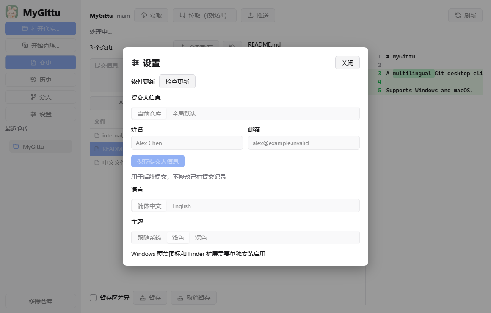

<p align="center"></p>

# MyGittu

面向 Windows 和 macOS 的开源 Git 桌面客户端。使用 Go、MyGo 原生界面与系统 Git，支持简体中文和 English。

[下载安装包](https://github.com/Oranjekop/MyGittu/releases/latest) · [更新日志](CHANGELOG.md) · [反馈问题](https://github.com/Oranjekop/MyGittu/issues)

## 下载安装

当前版本为 **v0.0.1 开发预览版**。每个平台只需下载一个安装包，无需判断 CPU 类型。

| 系统 | 安装包 | 处理器 |
| --- | --- | --- |
| Windows 10/11 64 位 | `MyGittu-0.0.1-Windows-Setup.exe` | 安装时自动选择原生 x64 / ARM64 |
| macOS 13 及以上 | `MyGittu-0.0.1-macOS.pkg` | Universal，原生支持 Intel / Apple Silicon |

安装程序及引导内容使用中文。macOS 系统安装器自身的按钮语言由系统决定。安装后可在应用设置中切换中文或英文。

先安装系统 Git：[Git for Windows](https://git-scm.com/downloads/win)；macOS 可使用 Xcode Command Line Tools 或已有 Git。执行 `git --version` 可确认是否就绪。

发布页提供 `SHA256SUMS.txt`。安装包尚未进行 Windows 开发者签名、Apple Developer ID 签名或公证，系统可能提示来源未验证；请核对下载来源和校验和。

## 使用

1. 启动 MyGittu，点击“打开仓库…”选择目录，选择后直接进入仓库。
2. 也可以拖入仓库文件夹，或按 Ctrl+O / macOS ⌘O；最近仓库按打开时间排列。
3. 在“变更”中选择文件，右侧并排比较暂存区或工作区内容；暂存文件、填写提交信息并提交。点击当前提交人可修改姓名、邮箱。
4. 使用“克隆…”下载仓库，在历史和分支页查看记录与管理分支。

姓名和邮箱可以保存到当前仓库或全局 Git 默认配置，仓库配置优先。修改只影响后续提交。保存使用配置锁和候选文件整体替换，避免姓名和邮箱只更新一部分。

设置以弹窗打开，支持 Esc、点击遮罩或关闭按钮退出，保留当前工作区和提交草稿。



支持的操作：

- Status、文件/全部暂存、取消暂存、Commit。
- 历史分页、搜索提交信息、提交详情、暂存区与工作区 Diff。
- 创建、切换、删除已合并分支和合并。
- Fetch、仅快进 Pull 和 Push。
- 中英文切换、跟随系统/浅色/深色主题、仓库注册恢复。
- 启动后后台检查稳定版更新，此后每六小时检查一次；设置中也可手动检查。发现新版后打开官方发布页下载。

远程认证沿用系统 Git credential helper 或 SSH agent。后台不提供终端密码输入，请先配置 Git 认证。Commit、Merge 会执行仓库配置的 Hook，应只对可信仓库执行操作。移除最近仓库记录不会删除仓库文件。

## 文件管理器集成

**Windows**：安装时可选资源管理器右键菜单、三种状态图标。系统会限制覆盖图标槽位，启用或卸载后可能需要重启资源管理器。多选时打开第一个所选路径所在仓库，不自动批量暂存。

右键操作集中在带兔子图标的 **MyGittu** 子菜单。本地 Git 目录显示变更、拉取、提交、推送、历史、差异，其他目录显示克隆。拉取、推送先打开客户端，由用户执行。Windows 11 现代菜单已实现 `IExplorerCommand` 和 sparse package 清单，但正式启用还需要受信任的发布者签名；当前未签名安装包使用传统菜单。构建、注册和实机验收见 [现代菜单部署](docs/runbooks/modern-menu.md)。

**macOS**：Finder Sync 源码已提供，但需要开发者签名、App Group 与沙盒通信验证。v0.0.1 的默认安装包仅安装桌面客户端与 Agent，暂不启用 Finder 扩展。签名开发构建见 [原生集成手册](docs/runbooks/integration.md)。

Rebase、Cherry-pick、Blame、Stash、Tag、LFS、Submodule 管理和三方合并尚未提供。真实大仓库、系统扩展、签名升级与性能验收状态见 [验收记录](docs/acceptance.md)。

## 从源码构建

需要 Go 1.27.4、Git。Windows 安装包还需 Visual Studio C++ x64/ARM64 工具链、CMake 和 Inno Setup 6.5+；macOS 安装包需 Xcode Command Line Tools。

```powershell
git clone https://github.com/Oranjekop/MyGittu.git
cd MyGittu
go test ./...
go vet ./...
go build -o bin/agent.exe ./cmd/agent
go build -ldflags=-H=windowsgui -o bin/desktop.exe ./cmd/desktop
.\bin\desktop.exe
```

macOS 开发时在同一目录构建 `agent` 和 `desktop`（不带 `.exe`），再启动 `desktop`。桌面端自动启动同目录 Agent，界面关闭后 Agent 继续维护缓存。

构建通用安装包：

```powershell
# Windows：同一个安装程序包含两个架构
.\packaging\windows\release.ps1
```

```bash
# macOS：lipo 合并 Intel 与 Apple Silicon 二进制
bash packaging/darwin/release.sh
```

产物位于 `dist/release`。构建使用 `VERSION`，可执行文件资源和图标已包含在源码中。图标重新生成说明见 [图标来源](docs/branding.md)。

## 标签发布

普通 `main` 推送会运行测试并构建两个平台安装包，保存在 Actions Artifacts 中。发布新版本时：

1. 修改 `VERSION`，在 `CHANGELOG.md` 添加同版本条目。
2. 提交并推送代码，等待检查通过。
3. 推送与 `VERSION` 一致的标签：

```bash
git tag -a v0.0.1 -m "Release v0.0.1"
git push origin v0.0.1
```

Actions 校验版本，构建中文 Windows 安装程序和 macOS 通用安装包，全部成功后创建 GitHub Release，上传安装包及 SHA-256 校验和。标签与 `VERSION` 不匹配时会拒绝发布。后续版本使用新标签，不移动已有版本标签。

## 架构与性能

`cmd/desktop` 为原生界面，`cmd/agent` 提供 Git 服务、仓库注册、监听和内存快照。覆盖图标通过有界 IPC 查询缓存；菜单只检查路径上最多 64 层的 `.git` 标记，不遍历文件、不在 Explorer 中执行 Git。发现未打开的 Git 文件夹后，Agent 在后台建立状态缓存。Git 写操作逐仓库串行。

文本对比每侧最多 256 KiB、8000 行；二进制文件不进入文本编辑器。自动更新请求最长 5 秒、响应最多 256 KiB，失败不打断工作；不会自动执行下载的程序。

文件事件去抖 250ms，周期校验 30 秒，最多监听 2048 个目录、注册 256 个仓库。超出监听范围的目录由周期校验更新。Git 输出与 IPC 报文有大小上限。协议见 [IPC v1](docs/protocol/v1.md)。

## 开源许可

项目原创代码使用 [MIT License](LICENSE)，没有复制 TortoiseGit 源码。MyGo 和其他依赖保留各自许可证，见 [第三方声明](THIRD_PARTY_NOTICES.md) 和 [SBOM](docs/sbom.cdx.json)。图标由图像生成工具生成并保留生成说明。系统 Git 为外部依赖，不随安装包捆绑。
